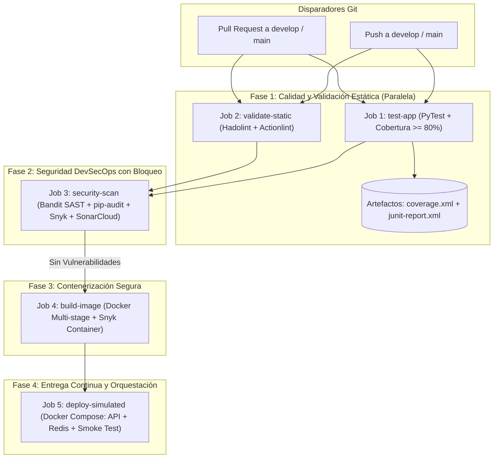

# Microservicio de Predicción Climática

Microservicio REST desarrollado con Python y FastAPI. Expone un endpoint de consulta meteorológica y cuenta con una arquitectura de integración y entrega continua (CI/CD) automatizada mediante GitHub Actions, diseñada conforme a estándares de ingeniería DevOps y buenas prácticas de desarrollo colaborativo.

---

## Índice

1. [Requisitos e Instalación Local](#requisitos-e-instalación-local)
2. [Ejecución de Pruebas Automatizadas](#ejecución-de-pruebas-automatizadas)
3. [Especificación del Endpoint](#especificación-del-endpoint)
4. [Estrategias y Modelos de Ramificación (Branching Strategies)](#estrategias-y-modelos-de-ramificación-branching-strategies)
   - [Análisis de Modelos: GitFlow, GitHub Flow y Trunk-Based](#análisis-de-modelos-gitflow-github-flow-y-trunk-based)
   - [Tabla Comparativa de Modelos](#tabla-comparativa-de-modelos)
   - [Justificación Técnica del Modelo Seleccionado](#justificación-técnica-del-modelo-seleccionado)
5. [Guía de Buenas Prácticas para el Uso de Repositorios DevOps](#guía-de-buenas-prácticas-para-el-uso-de-repositorios-devops)
   - [1. Naming de Ramas y Flujos de Merge](#1-naming-de-ramas-y-flujos-de-merge)
   - [2. Convenciones de Mensajes de Commit](#2-convenciones-de-mensajes-de-commit)
   - [3. Estructura del Proyecto y Organización de Carpetas](#3-estructura-del-proyecto-y-organización-de-carpetas)
   - [4. Control de Versiones: SemVer, Git Tags y GitHub Releases](#4-control-de-versiones-semver-git-tags-y-github-releases)
6. [Contenerización con Docker](#contenerización-con-docker)
7. [Integración y Entrega Continua (CI/CD) en GitHub Actions](#integración-y-entrega-continua-cicd-en-github-actions)
   - [Arquitectura y Diagrama de Flujo del Pipeline](#arquitectura-y-diagrama-de-flujo-del-pipeline)
   - [Detalle de los Jobs Automatizados](#detalle-de-los-jobs-automatizados)
   - [Garantía de Trazabilidad y Políticas de Calidad](#garantía-de-trazabilidad-y-políticas-de-calidad)
   - [Seguridad Continua: Dependabot, Snyk y SonarCloud](#seguridad-continua-dependabot-snyk-y-sonarcloud)
   - [Estrategia de Orquestación y Escalabilidad con Docker Compose](#estrategia-de-orquestación-y-escalabilidad-con-docker-compose)
8. [Trazabilidad del Flujo Colaborativo Simulado](#trazabilidad-del-flujo-colaborativo-simulado)

---

## Requisitos e Instalación Local

### Requisitos Previos

- Python 3.11 o superior.
- Gestor de paquetes `pip`.
- Git instalado y configurado en el sistema.

### Instalación de Dependencias

Se recomienda la creación de un entorno virtual:

```bash
# Crear entorno virtual
python -m venv .venv

# Activar entorno virtual
# En Windows (PowerShell):
.venv\Scripts\Activate.ps1
# En Linux / macOS:
source .venv/bin/activate

# Instalar dependencias de producción y desarrollo
pip install -r requirements.txt
pip install -r requirements-dev.txt
```

### Ejecución del Servidor

```bash
uvicorn main:app --reload --host 127.0.0.1 --port 8000
```

El servicio estará disponible en `http://127.0.0.1:8000` y la documentación interactiva Swagger UI en `http://127.0.0.1:8000/docs`.

---

## Ejecución de Pruebas Automatizadas

El proyecto incluye una suite de pruebas unitarias y de integración implementadas con `pytest` y `TestClient`:

```bash
pytest test_main.py -v --cov=main --cov-fail-under=80
```

Estas pruebas verifican:
- Código de estado HTTP 200 en consultas válidas.
- Integridad y tipado de los campos devueltos en el esquema JSON (`location`, `temperature`, `status`, `wind_speed_kmh`).
- Comportamiento y cabeceras de seguridad del middleware CORS.
- Cobertura de código igual o superior al 80%.

---

## Especificación del Endpoint

### `GET /weather`

Consulta el pronóstico climático actual de la estación meteorológica configurada.

#### Respuesta Exitosa (`HTTP 200 OK`)

```json
{
  "location": "Valparaíso",
  "temperature": 18,
  "status": "Soleado",
  "wind_speed_kmh": 12
}
```

---

## Estrategias y Modelos de Ramificación (Branching Strategies)

### Análisis de Modelos: GitFlow, GitHub Flow y Trunk-Based

En el desarrollo de software moderno y la adopción de prácticas DevOps, la estrategia de ramificación define las reglas para aislar, integrar y desplegar código de forma colaborativa, minimizando conflictos y maximizando la estabilidad del software.

#### 1. GitFlow
Propuesto por Vincent Driessen, es un modelo robusto y estructurado basado en ramas de larga duración (`main` y `develop`) y ramas transitorias especializadas (`feature/*`, `release/*`, `hotfix/*`).
- **`main`**: Almacena el historial oficial de lanzamientos en producción. Cada commit en esta rama corresponde a una versión estable y etiquetada (tag).
- **`develop`**: Rama de integración continua donde convergen las funcionalidades terminadas antes de preparar un release.
- **`feature/*`**: Ramas aisladas creadas desde `develop` para desarrollar nuevas capacidades, integradas mediante Pull Requests tras revisión.
- **`hotfix/*`**: Ramas de emergencia originadas directamente desde `main` para resolver fallos críticos en producción sin interrumpir el trabajo en curso en `develop`.

#### 2. GitHub Flow
Es un flujo de trabajo simplificado, centrado en entrega continua y ciclos rápidos de despliegue:
- Posee una única rama principal (`main` o `master`), la cual **siempre** debe estar en un estado desplegable a producción.
- Para cualquier cambio, se crea una rama descriptiva directamente desde `main`.
- La integración se realiza mediante Pull Request, donde se ejecutan pruebas automáticas y revisión por pares.
- Una vez aprobado el PR, el código se despliega a producción antes o inmediatamente después de hacer el merge en `main`.

#### 3. Trunk-Based Development (TBD)
Es la estrategia predilecta en organizaciones con alta madurez DevOps (ej. Google, Meta):
- Todos los desarrolladores realizan commits frecuentemente en una única rama troncal (`trunk` o `main`), ya sea directamente o a través de ramas efímeras de muy corta vida (menos de 24 a 48 horas).
- Depende de una infraestructura de CI extraordinariamente rápida y confiable que valide cada cambio en minutos.
- Utiliza **Feature Flags** (Feature Toggles) para desacoplar el despliegue del código del lanzamiento de la funcionalidad a los usuarios finales.

---

### Tabla Comparativa de Modelos

| Criterio | GitFlow | GitHub Flow | Trunk-Based Development |
| :--- | :--- | :--- | :--- |
| **Complejidad de Ramas** | Alta (múltiples ramas de larga duración y soporte) | Baja (una rama principal + ramas breves) | Mínima (una única rama troncal `main`/`trunk`) |
| **Ramas Principales** | `main` (producción) y `develop` (integración) | Solo `main` | Solo `main` / `trunk` |
| **Frecuencia de Despliegue** | Programada / por versiones (Releases periódicos) | Continua (múltiples despliegues diarios a producción) | Altísima frecuencia (integraciones múltiples al día) |
| **Manejo de Errores Críticos** | Ramas dedicadas `hotfix/*` desde `main` | Rama temporal desde `main` con despliegue inmediato | Fix directo en el troncal o desactivación con Feature Flag |
| **Madurez de CI/CD Requerida** | Media (automatización de compilación y pruebas por rama) | Alta (pruebas y despliegue continuo automáticos) | Muy Alta (tests e2e ultrarrápidos, telemetría y flags) |
| **Mantenimiento de Versiones** | Excelente (facilita mantener versiones legacy concurrentes) | Bajo (solo la última versión en producción existe) | Bajo (el troncal siempre avanza hacia adelante) |
| **Riesgo de "Merge Hell"** | Moderado a Alto si las ramas de soporte duran demasiado | Bajo | Casi nulo (integraciones pequeñas y frecuentes) |

---

### Justificación Técnica del Modelo Seleccionado

Para este microservicio se ha implementado y justificado la adopción de **GitFlow**, fundamentada en los siguientes factores técnicos y organizacionales:

1. **Aislamiento Seguro entre Desarrollo y Producción:**  
   Al tratarse de una arquitectura orientada a microservicios que alimenta servicios dependientes, la separación estricta entre la rama de integración (`develop`) y la rama de producción (`main`) garantiza que ningún cambio experimental o en desarrollo impacte la disponibilidad del entorno productivo.
2. **Control y Auditoría de Cambios mediante Quality Gates:**  
   GitFlow exige que cada nueva característica sea aislada en una rama `feature/*` y evaluada mediante Pull Requests antes de incorporarse a `develop`. Esto facilita la revisión de pares, la trazabilidad del código y la ejecución del pipeline CI previo al merge.
3. **Flujo Estandarizado de Respuesta ante Incidentes (`hotfix/*`):**  
   Permite corregir incidencias críticas en producción de forma inmediata mediante ramas `hotfix/*` derivadas de `main`, aplicando el parche directamente a producción y luego retroalimentando la rama `develop`, sin verse obligado a publicar características incompletas que aún residan en el flujo de desarrollo.
4. **Por qué no GitHub Flow:**  
   GitHub Flow asume un entorno de despliegue continuo a producción tras cada merge en `main`. Omitir una rama de integración (`develop`) incrementaría el riesgo de inestabilidad en la rama principal durante ciclos de validación grupal.
5. **Por qué no Trunk-Based Development:**  
   Trunk-Based requiere una arquitectura de Feature Flags madura y un suite exhaustivo de pruebas end-to-end con monitoreo sintético avanzado. Para la fase actual del microservicio, GitFlow proporciona las salvaguardas estructurales necesarias para evitar regresiones.

---

## Guía de Buenas Prácticas para el Uso de Repositorios DevOps

Esta guía establece el estándar operativo para equipos de desarrollo en entornos DevOps ágiles y colaborativos, cubriendo los 4 pilares fundamentales exigidos para la gestión de repositorios:

### 1. Naming de Ramas y Flujos de Merge

La nomenclatura de ramas debe ser semántica, autodescriptiva y en minúsculas, utilizando guiones para separar palabras (`kebab-case`).

- **Funcionalidades (`feature/<nombre>`):**  
  Nuevas capacidades del microservicio. Nacen desde `develop` y se integran exclusivamente a `develop`.  
  *Ejemplo:* `feature/weather-endpoint`, `feature/contenedores-orquestacion`.
- **Correcciones críticas (`hotfix/<nombre>`):**  
  Reparación de bugs críticos detectados en producción. Nacen desde `main`, se integran a `main` y posteriormente se sincronizan hacia `develop`.  
  *Ejemplo:* `hotfix/cors-error`.
- **Preparación de lanzamientos (`release/<versión>`):**  
  Estabilización de una versión próxima a publicarse. Nacen desde `develop` y se integran tanto a `main` como a `develop`.  
  *Ejemplo:* `release/v2.0.0`.

#### Políticas de Protección de Ramas
- **Prohibición de push directo:** Tanto `main` como `develop` están protegidas; todos los cambios deben ingresar a través de Pull Requests.
- **Revisión obligatoria:** Al menos un desarrollador del equipo debe aprobar el Pull Request antes de su fusión.
- **Comprobaciones de estado obligatorias (Status Checks):** El pipeline CI/CD (`ci.yml`) debe finalizar exitosamente antes de habilitar el botón de merge.
- **Eliminación post-merge:** Toda rama de soporte (`feature/*`, `hotfix/*`) debe eliminarse del repositorio remoto una vez que su PR haya sido integrado para evitar ramas huérfanas.

---

### 2. Convenciones de Mensajes de Commit

El equipo adopta el estándar internacional **Conventional Commits (v1.0.0)** para garantizar un historial limpio, legible y automatizable.

#### Formato Estándar
```text
<tipo>(<alcance opcional>): <descripción concisa en modo imperativo y minúsculas>

[cuerpo explicativo opcional del cambio y su motivación]

[referencias a issues, pull requests o breaking changes opcionales]
```

#### Tipos Permitidos
- `feat:` Incorporación de una nueva funcionalidad.
- `fix:` Corrección de un defecto o error de software.
- `docs:` Modificaciones exclusivas en la documentación (README, especificaciones).
- `test:` Inclusión o corrección de pruebas unitarias o de integración.
- `ci:` Cambios en pipelines de automatización o workflows (GitHub Actions).
- `refactor:` Reestructuración de código que no añade funcionalidades ni corrige bugs.
- `chore:` Tareas rutinarias de mantenimiento, dependencias o tooling.

#### Ejemplos Aplicados
```text
feat(docker): contenerizacion multi-stage y orquestacion con redis y politicas de escalabilidad
ci(actions): pipeline con pruebas pytest, cobertura 80, escaneos de seguridad y despliegue simulado
fix(docker): corrige CMD con uvicorn, usuario no-root, healthcheck /weather y limites de recursos
fix(ci): corrige sintaxis de job deploy-simulated y bloqueos SAST/SCA en pipeline
```

---

### 3. Estructura del Proyecto y Organización de Carpetas

La arquitectura del repositorio sigue una separación limpia de responsabilidades (Clean Directory Layout), separando código de aplicación, pruebas, pipelines, contenerización y metadatos de configuración:

```text
microservicio-clima/
├── .github/
│   ├── dependabot.yml           # Configuración de escaneo de dependencias automatizado
│   └── workflows/
│       └── ci.yml               # Pipeline CI/CD: Tests, Linting, Seguridad, Docker y Despliegue
├── .dockerignore                # Exclusiones del contexto Docker para builds rápidos y seguros
├── .gitignore                   # Exclusión de binarios, cachés y entornos virtuales locales
├── docker-compose.yml           # Orquestación multicontenedor (API + Redis), redes y recursos
├── Dockerfile                   # Contenerización Multi-stage segura no-root con Python 3.12-slim
├── main.py                      # Punto de entrada del microservicio FastAPI y endpoint /weather
├── test_main.py                 # Suite de pruebas unitarias automatizadas con pytest
├── requirements.txt             # Dependencias de producción estrictamente versionadas
├── requirements-dev.txt         # Dependencias de desarrollo, linting y pruebas (pytest, bandit)
└── README.md                    # Documentación técnica integral del proyecto DevOps
```

---

### 4. Control de Versiones: SemVer, Git Tags y GitHub Releases

El control de versiones garantiza trazabilidad histórica, reproducibilidad de despliegues y comunicación clara de cambios a clientes y operadores del sistema.

#### Estándar Semantic Versioning (SemVer 2.0.0)
El versionado del proyecto sigue la convención `vMAJOR.MINOR.PATCH`:

- **MAJOR (v1.0.0 / v2.0.0):** Cambios arquitectónicos mayores o modificaciones que rompen compatibilidad con versiones anteriores.
- **MINOR (v1.1.0):** Incorporación de nuevas funcionalidades que mantienen compatibilidad hacia atrás.
- **PATCH (v1.0.1):** Corrección de errores y vulnerabilidades que conservan compatibilidad total.

#### Estrategia de Etiquetado con Git Tags
```bash
# Crear un tag anotado sobre el commit actual en la rama main
git tag -a v2.0.0 -m "Release v2.0.0: Pipeline CI/CD completo, seguridad SAST/SCA y orquestacion con Docker Compose"

# Publicar el tag específico en el repositorio remoto GitHub
git push origin v2.0.0
```

---

## Contenerización con Docker

El microservicio se encuentra completamente contenerizado mediante una arquitectura **Multi-stage Build** definida en el [`Dockerfile`](file:///Dockerfile), siguiendo las mejores prácticas de la industria en seguridad, rendimiento y reproducibilidad:

### Características de la Contenerización:
1. **Construcción Multi-etapa (`python:3.12-slim`):** La etapa `builder` compila e instala las dependencias en `/install`, mientras que la etapa final de producción copia únicamente los paquetes requeridos y el código fuente (`main.py`), reduciendo el tamaño de la imagen y la superficie de ataque.
2. **Usuario sin Privilegios (`appuser`):** La aplicación se ejecuta bajo un usuario y grupo del sistema sin privilegios (`appuser:appgroup`), garantizando el principio de mínimo privilegio (Least Privilege) y evitando posibles escaladas de privilegios en el host.
3. **Caché de Capas (Layer Caching):** Se copia e instala `requirements.txt` previo al código de negocio, acelerando los tiempos de compilación cuando no cambian las dependencias.
4. **Healthcheck Nativo:** Se incluye una comprobación de salud periódica que evalúa la disponibilidad del endpoint `http://localhost:8000/weather`.

### Comandos de Construcción y Ejecución Local con Docker:

```bash
# Construir la imagen Docker localmente
docker build -t microservicio-clima:1.0 .

# Ejecutar el contenedor mapeando el puerto 8000
docker run -d --name clima-service -p 8000:8000 microservicio-clima:1.0

# Comprobar estado y healthcheck del contenedor
docker ps

# Probar el microservicio en ejecución
curl http://localhost:8000/weather

# Ver logs del contenedor
docker logs clima-service

# Detener y eliminar el contenedor
docker stop clima-service && docker rm clima-service
```

---

## Integración y Entrega Continua (CI/CD) en GitHub Actions

El repositorio cuenta con una arquitectura de tubería CI/CD completa de 5 etapas (Jobs), orquestada en GitHub Actions mediante el archivo [`.github/workflows/ci.yml`](file:///.github/workflows/ci.yml).

### Arquitectura y Diagrama de Flujo del Pipeline

El pipeline implementa validación temprana en paralelo (Shift-Left) y compuertas estrictas de calidad y seguridad (Quality & Security Gates) que bloquean el flujo antes de construir la imagen o desplegar:



---

### Detalle de los Jobs Automatizados

#### 1. Job `test-app` (Pruebas Unitarias y Cobertura)
- **Entorno:** `ubuntu-latest` con Python 3.12 y caché de `pip`.
- **Ejecución y Bloqueo por Calidad:** Ejecuta `pytest test_main.py -v --cov=main --cov-fail-under=80 --cov-report=xml --junitxml=junit-report.xml`. Si alguna prueba falla o la cobertura de código cae por debajo del **80%**, el pipeline se detiene inmediatamente.
- **Artefactos de Trazabilidad:** Publica `coverage.xml` y `junit-report.xml` mediante `actions/upload-artifact@v4`.

#### 2. Job `validate-static` (Validación Estática de Infraestructura)
- **Hadolint (`hadolint/hadolint-action@v3.1.0`):** Audita el `Dockerfile` verificando el cumplimiento de buenas prácticas de seguridad y optimización de capas.
- **Actionlint (`raven-actions/actionlint@v2`):** Verifica estáticamente la sintaxis y seguridad de los workflows de GitHub Actions.

#### 3. Job `security-scan` (Seguridad SAST/SCA con Bloqueo)
- Requiere la aprobación previa de `test-app` y `validate-static`.
- **Bloqueo SAST con Bandit:** Ejecuta `bandit -r main.py -ll`, deteniendo el pipeline si se detectan vulnerabilidades de severidad media o alta en el código Python.
- **Bloqueo SCA con pip-audit y Snyk:** Audita `requirements.txt` contra bases de datos de CVEs (`pip-audit` y `snyk/actions/python@master` con `--severity-threshold=high`), bloqueando la ejecución ante dependencias vulnerables.
- **SonarCloud Quality Gate:** Ejecuta el análisis estático con `-Dsonar.qualitygate.wait=true`, consumiendo el reporte `coverage.xml` y bloqueando el pipeline si no se cumple el umbral de calidad.

#### 4. Job `build-image` (Construcción y Escaneo de Imagen Docker)
- Construye la imagen Docker multi-stage etiquetándola tanto con la versión semántica (`microservicio-clima:1.0`) como con el hash inmutable del commit (`microservicio-clima:${GITHUB_SHA}`).
- Ejecuta `snyk/actions/docker@master` (`--severity-threshold=high`) para escanear vulnerabilidades a nivel de sistema operativo y paquetes dentro del contenedor.

#### 5. Job `deploy-simulated` (Despliegue Automático y Orquestación)
- **Orquestación Multicontenedor:** Levanta el stack completo (`redis-cache` + `api-clima`) mediante `docker compose up -d --build`.
- **Verificación de Salud y Smoke Test:** Comprueba el estado de los contenedores (`docker compose ps`), realiza una petición HTTP real con `curl -sSf http://localhost:8000/weather` para certificar la respuesta `200 OK` en vivo e imprime los logs de auditoría (`docker compose logs api-clima`).
- **Limpieza Garantizada:** Ejecuta `docker compose down -v` con `if: always()` para liberar los recursos del runner.

---

### Garantía de Trazabilidad y Políticas de Calidad

1. **Trazabilidad End-to-End (Desde Desarrollo hasta Producción):**
   - **Asociación Commit-Imagen:** Cada ejecución del pipeline etiqueta la imagen Docker con el SHA exacto del commit (`microservicio-clima:${GITHUB_SHA}`), permitiendo rastrear qué línea de código exacta originó cada contenedor desplegado.
   - **Flujo GitFlow Basado en Pull Requests:** Ningún cambio llega a `develop` o `main` sin un Pull Request revisado y vinculado a su rama de origen (`feature/*` o `fix/*`).
   - **Persistencia de Evidencias (Artefactos y Logs):** Cada corrida del pipeline almacena los artefactos XML de pruebas y cobertura (`coverage-report`) y deja registro auditable de los logs de arranque y respuestas HTTP del contenedor en el entorno simulado.
2. **Garantía de Calidad y Seguridad (Quality & Security Gates):**
   - **Umbral Mínimo de Cobertura (80%):** El flag `--cov-fail-under=80` impide integrar código sin pruebas unitarias suficientes.
   - **Bloqueos Automáticos por Vulnerabilidades (Fail-Fast):** Los jobs `validate-static`, `security-scan` y `build-image` actúan como compuertas bloqueantes (`needs:`). Si Hadolint, Bandit, pip-audit, Snyk o SonarCloud detectan un fallo, los jobs posteriores de construcción y despliegue se cancelan automáticamente.
   - **Actualización Preventiva con Dependabot:** El archivo [`.github/dependabot.yml`](file:///.github/dependabot.yml) revisa semanalmente los ecosistemas `pip`, `docker` y `github-actions`, abriendo PRs automáticos ante nuevas vulnerabilidades.

---

### Seguridad Continua: Dependabot, Snyk y SonarCloud

El proyecto implementa el principio de **DevSecOps** integrando seguridad automatizada en cada nivel:

1. **GitHub Dependabot (`.github/dependabot.yml`):**
   - Rastreo semanal de dependencias de Python (`pip`), imágenes base (`docker`) y acciones de GitHub (`github-actions`).
   - Generación automática de Pull Requests con parches de seguridad al detectar vulnerabilidades.
2. **Análisis SAST y SCA (Bandit, pip-audit, Snyk y SonarCloud):**
   - **SCA (Software Composition Analysis):** Detecta vulnerabilidades conocidas en librerías de terceros e imágenes de contenedor.
   - **SAST (Static Application Security Testing):** Analiza el código fuente en reposo para identificar debilidades de seguridad y problemas de mantenibilidad antes del despliegue.

---

### Estrategia de Orquestación y Escalabilidad con Docker Compose

El archivo [`docker-compose.yml`](file:///docker-compose.yml) define una arquitectura orquestada lista para entornos de mediana y gran envergadura:

- **Servicios Acoplados con Control de Salud (`depends_on: service_healthy`):** El servicio `api-clima` espera a que `redis-cache` (`redis:7-alpine`) responda `PONG` en su healthcheck antes de iniciar.
- **Segmentación de Redes (`frontend` y `backend`):** `api-clima` se conecta a ambas redes, mientras que `redis-cache` permanece aislado exclusivamente en la red `backend`, sin exposición de puertos al exterior.
- **Parámetros de Escalabilidad y Límites de Recursos:** Ambos contenedores definen cuotas estrictas de CPU (`cpus: "0.50"`) y memoria (`memory: 256M`) junto con reservas garantizadas (`reservations`) y descriptores de archivo (`ulimits.nofile: 65536`) para soportar alta concurrencia sin agotar los recursos del host.
- **Hardening de Seguridad en Runtime:** Se aplica `security_opt: [no-new-privileges:true]` en todos los servicios orquestados.

#### Comandos de Orquestación en Entorno Simulado:

```bash
# Levantar el stack orquestado (API + Redis) en segundo plano
docker compose up -d --build

# Comprobar el estado de los contenedores y sus healthchecks
docker compose ps

# Ejecutar prueba de humo sobre el servicio desplegado
curl http://localhost:8000/weather

# Detener el entorno simulado y remover volúmenes
docker compose down -v
```

---

## Trazabilidad del Flujo Colaborativo Simulado

El proyecto evidencia el cumplimiento del flujo GitFlow y la trazabilidad del código a través de los siguientes Pull Requests y ramas integradas en GitHub:

1. **`feature/setup-api` (PR #1):** Configuración inicial del framework FastAPI y estructura base del pipeline de GitHub Actions.
2. **`feature/weather-endpoint` (PR #2):** Implementación del endpoint de negocio `GET /weather` con entrega de métricas climáticas.
3. **`hotfix/cors-error` (PR #3):** Integración de urgencia directa para resolver el bloqueo por políticas de CORS en clientes web externos mediante `CORSMiddleware`.
4. **`feature/actualizar-documentacion` (PR #4):** Refactorización y ampliación de las especificaciones técnicas y operativas del microservicio.
5. **Release `v1.0.0`:** Etiquetado formal inmutable sobre la rama `main` y publicación del primer release del proyecto.
6. **`feature/contenedores-orquestacion` (PR #5):** Implementación de `Dockerfile` multi-stage y orquestación multicontenedor con Redis en `docker-compose.yml`.
7. **`feature/pipeline-cicd-seguridad` (PR #6):** Automatización del pipeline CI/CD de 5 etapas con cobertura obligatoria, bloqueos de seguridad SAST/SCA, despliegue simulado y documentación de trazabilidad.

---

### Comandos Git Clave Utilizados en el Ciclo de Vida

```bash
# Clonar el repositorio
git clone https://github.com/MartinLopez1011/microservicio-clima.git

# Creación e intercambio de rama de trabajo
git checkout -b feature/nueva-caracteristica

# Registro de cambios aplicando Conventional Commits
git add .
git commit -m "feat(weather): agrega soporte para pronóstico extendido"

# Publicación de la rama hacia el repositorio remoto
git push -u origin feature/nueva-caracteristica

# Sincronización y actualización de ramas
git checkout develop
git pull origin develop

# Creación de etiqueta de versión inmutable
git tag -a v2.0.0 -m "Release v2.0.0"
git push origin v2.0.0
```
